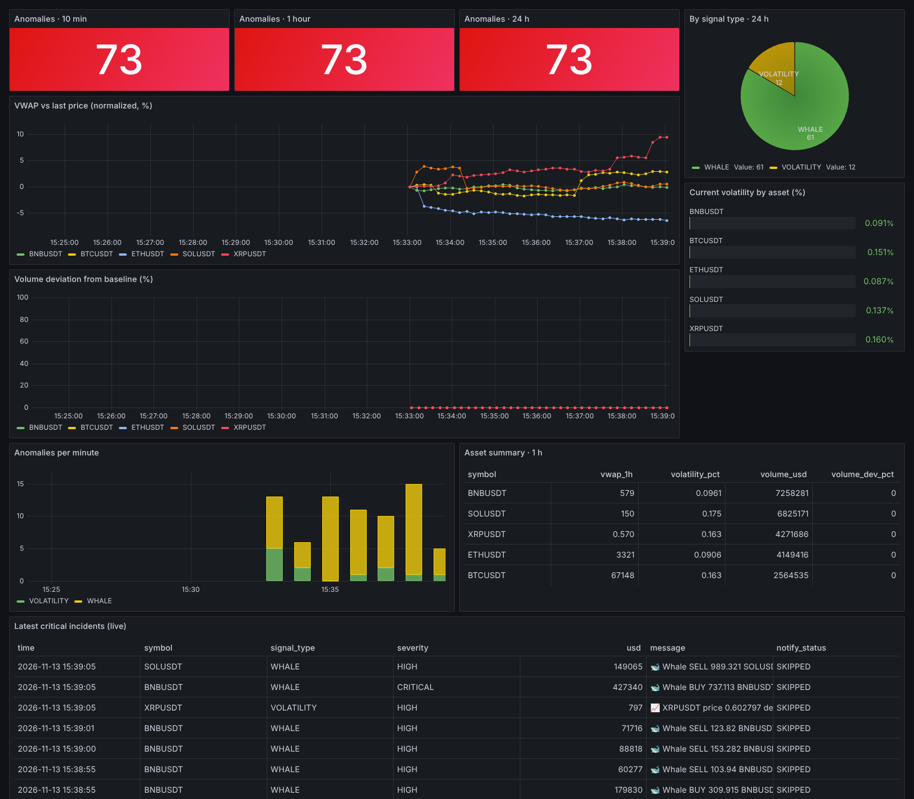
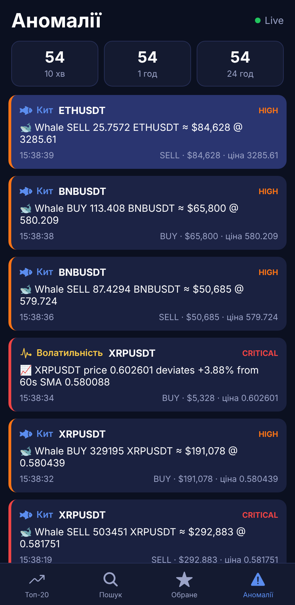

# CryptoMonitor

Мобільний додаток на **React Native (Expo)** для моніторингу криптовалют:

- Список **топ-20 криптовалют** з API [CoinGecko](https://www.coingecko.com/en/api) (за капіталізацією).
- **Графік зміни ціни** для будь-якої монети (інтервали 1Д / 7Д / 30Д / 90Д / 1Р).
- **Пошук** монети за назвою або символом.
- **Додавання в обране** — список зберігається на пристрої через AsyncStorage.

## Стек

| Шар | Технологія |
| --- | --- |
| Каркас | Expo SDK 51 (React Native 0.74) |
| Навігація | `@react-navigation/native`, `bottom-tabs`, `native-stack` |
| HTTP | `fetch` (без додаткових бібліотек) |
| Графіки | `react-native-chart-kit` + `react-native-svg` |
| Сховище | `@react-native-async-storage/async-storage` |
| Іконки | `@expo/vector-icons` (Ionicons) |
| Безпечні зони | `react-native-safe-area-context` |

## Структура проєкту

```
CryptoMonitor/
├── App.js                       # вхідна точка: провайдери + навігація
├── app.json                     # конфіг Expo
├── babel.config.js
├── index.js
├── package.json
└── src/
    ├── api/
    │   └── coingecko.js         # клієнт CoinGecko (топ, пошук, графік)
    ├── components/
    │   └── CoinListItem.js      # рядок монети у списках
    ├── context/
    │   └── FavoritesContext.js  # обране + AsyncStorage
    ├── screens/
    │   ├── HomeScreen.js        # топ-20 з оновленням
    │   ├── SearchScreen.js      # пошук з debounce
    │   ├── FavoritesScreen.js   # список обраного
    │   └── DetailScreen.js      # деталі + графік + статистика
    └── theme/
        └── colors.js            # темна тема
```

## Запуск

Потрібен Node.js ≥ 18.

```bash
git clone <URL цього репозиторію>
cd CryptoMonitor
npm install --legacy-peer-deps
npx expo start
```

Далі:

- натисніть `w` у консолі — відкрити **в браузері** (web-збірка);
- натисніть `i` / `a` — запустити у симуляторі iOS / Android;
- або зіскануйте QR-код у застосунку **Expo Go** на телефоні.

## API

Використовується безкоштовний публічний CoinGecko API (без ключа):

| Призначення | Endpoint |
| --- | --- |
| Топ-20 за капіталізацією | `GET /coins/markets?vs_currency=usd&order=market_cap_desc&per_page=20` |
| Оновлення обраного | `GET /coins/markets?ids=<id1,id2,...>` |
| Пошук | `GET /search?query=<text>` |
| Графік ціни | `GET /coins/{id}/market_chart?vs_currency=usd&days={1\|7\|30\|90\|365}` |

---

# CryptoMonitor Stream — розподілена система потокового моніторингу

Бекенд-конвеєр (Stream Data Pipeline) для аналізу угод у реальному часі, детекції аномалій та сповіщень.

## Архітектура

```
Binance WebSocket (@trade) / симулятор ринку
              │ JSON stream
              ▼
   worker (asyncio): фільтрація, ковзні вікна, VWAP
        │                          │
        ▼ усі угоди                ▼ лише аномалії + 10-сек метрики
   MongoDB (trades)            PostgreSQL (anomalies, market_metrics, monitoring_rules)
                                   │  trigger → pg_notify('anomalies')
                     ┌─────────────┴──────────────┐
                     ▼                            ▼
              Grafana дашборд            api (FastAPI): Telegram-бот,
              (http://localhost:3000)    WebSocket /ws/alerts → React Native
```

| Компонент | Шлях | Опис |
|---|---|---|
| Потоковий обробник | `backend/worker/` | `sources.py` (Binance / симулятор, авто-fallback), `detector.py` (3 критерії), `main.py` (запис у БД) |
| API + сповіщення | `backend/api/main.py` | LISTEN/NOTIFY, Telegram, WebSocket, REST |
| Схема БД | `backend/db/init.sql` | інциденти, правила, метрики, тригер сповіщень |
| Дашборд | `backend/grafana/` | автопровіжинінг datasource + дашборду |
| Мобільний клієнт | `src/screens/AlertsScreen.js` | вкладка «Аномалії»: лічильники + live-стрічка |

## Критерії аномалій (налаштовуються в таблиці `monitoring_rules`)

1. **WHALE** — одна угода > $50 000 (CRITICAL при > 5× порогу).
2. **VOLATILITY** — відхилення ціни від ковзного середнього за 60 с > 1.5 % (cooldown 30 с).
3. **VOLUME_SPIKE** — сума обсягу за ковзне 10-хв вікно > 3× базового рівня (EMA, оновлюється щохвилини після 10-хв прогріву).

Правила перечитуються воркером кожні 30 с; змінити можна через `PUT /api/rules/{WHALE|VOLATILITY|VOLUME_SPIKE}`:

```bash
curl -X PUT localhost:8000/api/rules/WHALE -H 'Content-Type: application/json' -d '{"threshold": 100000}'
```

## Запуск

```bash
cp backend/.env.example backend/.env   # за бажанням: токен Telegram, SOURCE=simulator
docker compose up -d --build
```

- Grafana: http://localhost:3000 (admin / admin) — дашборд «CryptoMonitor Stream»
- API: http://localhost:8000/docs, WebSocket: `ws://localhost:8000/ws/alerts`
- Мобільний клієнт: `npm start` → вкладка «Аномалії». На телефоні вкажіть адресу ПК:
  `EXPO_PUBLIC_API_URL=http://192.168.x.x:8000 npm start`

**Telegram:** створіть бота у @BotFather, отримайте `chat_id` (напр. через @userinfobot), впишіть
`TELEGRAM_BOT_TOKEN` і `TELEGRAM_CHAT_ID` у `backend/.env`. Надсилаються події з severity ≥ `TELEGRAM_MIN_SEVERITY`;
статус доставки пишеться в `anomalies.notify_status` (SENT / FAILED / SKIPPED).

Якщо Binance недоступний (блокування регіону, немає мережі) — воркер автоматично переходить на симулятор,
який генерує випадковий ринок із «китами», ціновими стрибками та сплесками обсягу.

## REST API

| Метод | Шлях | Опис |
|---|---|---|
| GET | `/api/alerts?limit=&symbol=&signal_type=` | останні інциденти |
| GET | `/api/stats` | кількість аномалій за 10 хв / 1 год / 24 год, VWAP/волатильність по активах |
| GET | `/api/metrics/{symbol}?minutes=60` | часовий ряд метрик |
| GET/PUT | `/api/rules[/{type}]` | правила моніторингу |
| WS | `/ws/alerts` | live-потік аномалій |

## Перевірка

```bash
docker compose exec mongo mongosh --quiet --eval 'db.getSiblingDB("cryptomonitor").trades.countDocuments()'
docker compose exec postgres psql -U crypto cryptomonitor -c "select signal_type, count(*) from anomalies group by 1"
cd backend/worker && python -m pytest -q   # юніт-тести детектора
```

 
